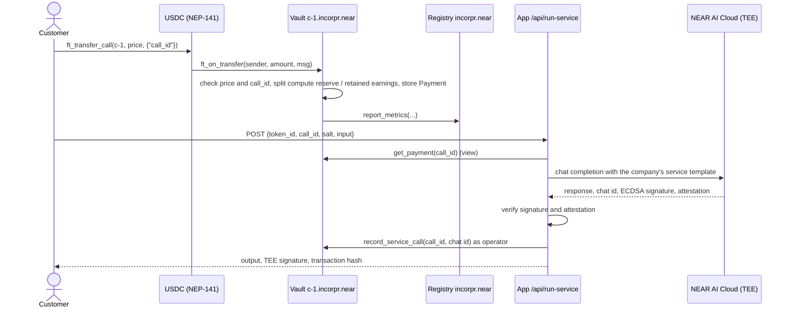
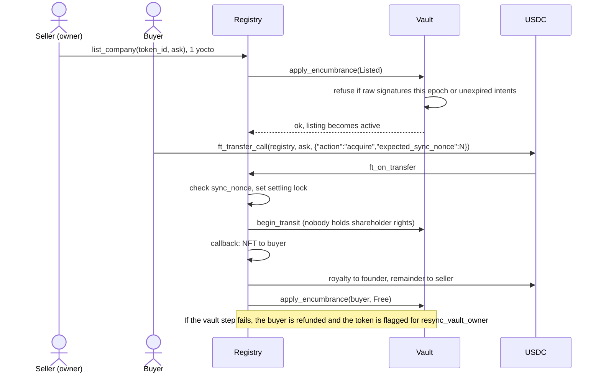
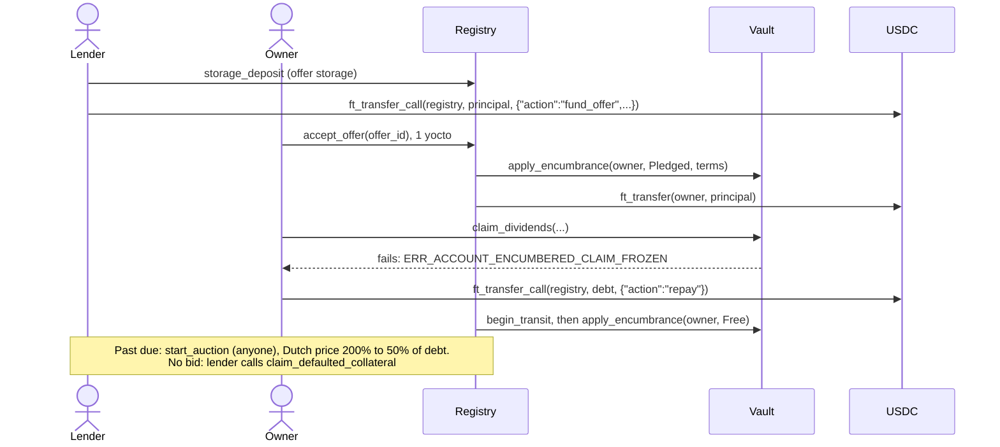
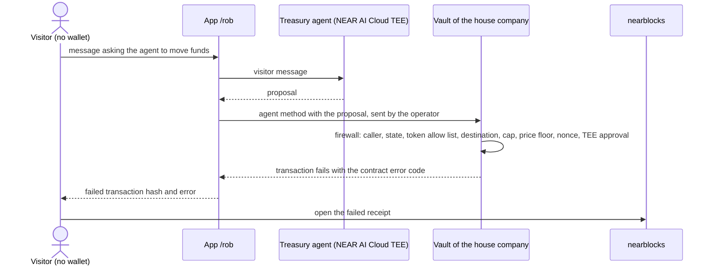

# Incorpr

Incorpr makes each NEP-171 NFT on NEAR a small AI company. Each company has its own keyless vault sub-account, its own BTC, SOL and EVM addresses through Chain Signatures, and a USDC income from paid API calls. The NFT holder can claim dividends, borrow USDC against the company, or sell it to a buyer in a single transaction.

**Judges, start here: [docs/JUDGES.md](docs/JUDGES.md)**

Deployment URL: added at submission.

Built for the NEAR Hackathon (Nov 1 to 14, 2026), track 10: NFTs That Do Something.

> Status on 2026-11-06: the registry is deployed on NEAR mainnet at protocol 88 as [`incorpr.near`](https://nearblocks.io/address/incorpr.near), with one company, Ledgerline Audit, whose keyless vault is [`c-1.incorpr.near`](https://nearblocks.io/address/c-1.incorpr.near). The full lifecycle has run on mainnet: a paid call served by NEAR AI Cloud with its TEE signature verified, listing, an atomic sale, a USDC loan, repayment and a dividend claim. Ten refused transactions are recorded: five from the owner while the company was listed or pledged, and five "Rob this company" attacks, including one where the treasury agent agreed in chat and the vault still refused. All 37 transactions are re-checked against the chain by `scripts/evidence.mjs` and listed in [docs/MAINNET_EVIDENCE.md](docs/MAINNET_EVIDENCE.md). Not yet run on mainnet: executing an approved treasury swap through intents.near, a cross-chain pay-in, and a Bitcoin spend from the vault's address.

## For judges: try it in 60 seconds

No wallet is needed. Use the deployment URL above.

1. **Do:** open `/exchange`.
   **See:** every company the registry holds, read from chain: its vault account, state (`FREE`, `LISTED` or `PLEDGED`), 30-day revenue booked from USDC transfers, retained earnings and ask.
2. **Do:** open `/rob` and try to get the house company's treasury agent to send you its money.
   **See:** the attempt goes to the vault as a real NEAR transaction and the vault refuses it. The page links the failed transaction on nearblocks, with the contract error code (for example `ERR_FIREWALL_BLOCKED_UNWHITELISTED_DESTINATION`) in the receipt. If the page says attempts are off, the server has not been given the stranger key yet (see [Deployment](#deployment)); the checks the vault runs are still listed on the page.
3. **Do:** open `/verify`.
   **See:** each claim the project makes, next to the test that checks it and the live transaction that shows it.

## Why the NFT is essential

The NFT is the only ownership record the company has. It is not a picture of a company held somewhere else.

- **No NFT, no company.** `incorporate_company` creates the vault sub-account `c-<id>.<registry>` and mints the NFT in the same flow. If the vault deployment fails, nothing is minted and the deposit is refunded.
- **No NFT, no vault control.** The vault accepts shareholder calls (`claim_dividends`, `rotate_treasury_epoch`, policy changes) only from the account the registry last recorded as the NFT owner.
- **No NFT, no signing rights.** The BTC, SOL and EVM keys are derived by `v1.signer` from the vault's own account id. Only the vault can ask for signatures on them, and it does so only for the current shareholder.
- **One transfer moves everything.** When the NFT changes hands through the registry, the vault records the new shareholder. The income stream, retained earnings, treasury addresses and signing rights all follow it. Nothing else has to be handed over, and the seller has no key to keep.

## Who holds which key

The vault sub-account has no access keys and no upgrade method. Anyone can check this with `view_access_key_list` on `c-<id>.<registry>`.

| Party | Can | Cannot (the contract refuses it) |
|---|---|---|
| Owner (NFT holder, the shareholder) | Claim dividends, sign raw L1 payloads, rotate the treasury epoch, set policy, list, pledge. All only while the company is `FREE` | Sign, claim or change policy while `LISTED`, `PLEDGED` or in transit. List or pledge after signing a raw payload this epoch (`ERR_RAW_SIGNATURES_THIS_EPOCH`) |
| Operator (treasury agent relay) | Ask the vault to build a swap or self-withdraw intent inside policy, with a TEE approval. Pay compute from the reserve to the fixed `compute_payee`. Mark a paid call as served | Supply bytes to sign, write the model prompt, choose a destination, report revenue, or use agent methods while encumbered |
| Registry | Update the vault's owner and encumbrance state. Hold listings, offers and loans | Sign anything on the vault's behalf or move the vault's funds |
| Buyer | Pay the ask with one `ft_transfer_call`. Become shareholder once the payment has settled | Gain shareholder rights before paying. Buy a listing that changed after it was read (`ERR_LISTING_CHANGED`, full refund) |
| Lender | Fund an offer. Start the Dutch auction after the due date. Claim the company if the auction ends with no bid | Touch the vault's funds or keys. Claim before the loan is past due and the auction window has closed |
| `v1.signer` (MPC network) | Produce a signature when the vault calls `sign` for one of its own derivation paths | Sign for the vault's paths on anyone else's request: the derived key depends on the calling account. Its trust assumption is that a threshold of MPC nodes follows the protocol |

One more key exists: `incorpr.near`, the registry account, keeps a full access key on the deployer's machine. It is the registry `owner` and can redeploy registry code. It cannot change vault code, and vaults have no keys, but a redeployed registry could reassign shareholders through `sync_owner`. Until that key is deleted, holders trust the deployer not to do so. The plan is to delete it once the default policy is final ([docs/DEPLOY.md](docs/DEPLOY.md) section 6).

## What is real and what is simulated

| Part | Status |
|---|---|
| Contracts | Real Rust contracts, `near-sdk` 5.29.1. Deployed on mainnet with `scripts/deploy.mjs` on 2026-11-06 at protocol 88: `incorpr.near` (registry, code hash `EZ4ZuzRAMPYv5rdU2kYj78FaecPSMY8rZHYTptTHEnqK`, the hash of `contracts/res/incorpr_registry.wasm`) and one vault, `c-1.incorpr.near`, with no access keys |
| Chain Signatures | Mainnet uses the real `v1.signer`; the vault reads its keys with `derived_public_key` and computes the addresses on-chain. The landing page derives its addresses from the live mainnet signer. The local sandbox uses a labelled signer double (`contracts/test-doubles/mpc-signer`) because it cannot reach the MPC network |
| NEAR AI Cloud TEE | Real inference on `cloud-api.near.ai`. The app checks the response signature, the Intel TDX quote and the NVIDIA GPU attestation. The deploy reads TEE signer addresses only from a live attestation report. A paid call was served on mainnet and recorded on the vault with `record_service_call`; its signature recovered to the attested signer. Without `NEAR_AI_API_KEY` the TEE routes answer HTTP 503; nothing is synthesized |
| Customer payments | Real USDC on NEAR through `ft_transfer_call`. Revenue is booked only by the vault's `ft_on_transfer` |
| Demo customer, buyer and lender | `demo-customer`, `demo-buyer` and `demo-lender` are accounts under `incorpr.near` controlled by the deployer. The sale and the loan are real contract executions, not trades between independent parties. Their payments count toward `revenue_30d` |
| Rob this company | Live on mainnet. `/api/rob/attempt` sends real transactions from `rob.incorpr.near` and `operator.incorpr.near`; the five recorded attacks were refused with `ERR_ONLY_CURRENT_SHAREHOLDER`, `ERR_FIREWALL_BLOCKED_UNWHITELISTED_DESTINATION`, `ERR_FIREWALL_PRICE_BELOW_FLOOR`, `ERR_TEE_SIGNATURE_UNTRUSTED` and `ERR_TEE_NOT_APPROVED`. Attempts cost the house gas, so they are rate limited per IP with a daily cap |
| Treasury rebalance | The contract path (`agent_swap_intent` with on-chain TEE approval) is implemented, tested on the sandbox against an intents double, and its refusals run on mainnet (see Rob this company). Executing an approved swap against `intents.near` is not in this release. The demo records real 1Click quotes with `dry: true` next to the vault's price floor |
| Cross-chain pay-in | Client code for paying in another token through 1Click exists (`web/src/lib/anyTokenPayment.ts`, mainnet only). It has not been run end to end and is not part of the demo script |
| L1 freshness check | `/api/verify-l1` reads BTC UTXOs and SOL/EVM nonces. It is advisory and not a contract gate. The contract-side protection is the pre-signed transaction rule below |
| Testnet | No `intents.near` and no 1Click on testnet. Payments use Test USDC, which has no value. The testnet path is scripted but has not been run for this release |
| Bitcoin spend | `scripts/demo.mjs --step btc-send` signs a P2WPKH spend through the vault and `v1.signer`. Tested on the sandbox with synthetic outpoints; nothing broadcast yet |

## How the main flows work

### Pay per call



A payment below the price, with a malformed `msg` or a reused `call_id` is refunded in full by `ft_on_transfer`. The app runs inference only for a payment the vault has booked.

### Sale, settled in one buyer transaction



The buyer signs once. On NEAR the steps run as separate receipts, so the registry locks the token, calls the vault first and moves funds only in the callback. The ordering is there so that a failed vault step refunds the buyer instead of leaving the seller paid and the buyer without the company.

### Pledge and loan



### Rob attempt



The firewall refuses any withdrawal whose destination is not the company's own current-epoch address. The error shown is the one the contract returned; which check fires first depends on what the attempt asked for. The demo script runs a second kind of robbery, by the owner: while the company is listed or pledged, `claim_dividends`, `request_shareholder_signature` and `nft_transfer` are each sent and recorded as failed transactions (`ERR_ACCOUNT_ENCUMBERED_CLAIM_FROZEN`, `ERR_ACCOUNT_ENCUMBERED_SIGNING_FROZEN`, `ERR_TOKEN_ENCUMBERED`).

## Architecture

Mainnet accounts (`incorpr.near`, `c-1.incorpr.near`, `operator.incorpr.near` and the three demo accounts exist; further vaults are created by `incorporate_company`):

| Account | Role | Signs |
|---|---|---|
| `incorpr.near` | `incorpr-registry`: NFTs, factory, listings, offers, loans | Its own key: deploy, `new`, `set_default_policy` |
| `c-<id>.incorpr.near` | `company-vault`, one per company | No keys. Acts only through its own contract code |
| `operator.incorpr.near` | Treasury agent relay and service operator | `record_service_call`, `pay_compute_bill`, agent methods |
| `demo-customer`, `demo-buyer`, `demo-lender` `.incorpr.near` | Demo counterparties, deployer-controlled | Their own demo transactions |
| `v1.signer` | Chain Signatures MPC | Signatures requested by a vault |
| `intents.near` | NEAR Intents verifier | Settles intents signed with a vault-only key |
| `17208628…33a1` | Native USDC on NEAR | Transfers |

The full design is in [docs/ARCHITECTURE.md](docs/ARCHITECTURE.md). Where it disagrees with `RUST_CONTRACTS_SPEC.md` or `BACKEND_AND_INTENTS_SPEC.md`, it wins; those two files are the original drafts.

## NEAR primitives used

| Primitive | Where |
|---|---|
| Sub-accounts as a factory, keyless and without upgrade method | `incorporate_company` in `contracts/incorpr-registry/src/lib.rs`; the registry embeds `contracts/res/company_vault.wasm` |
| NEP-171, NEP-177, NEP-178, NEP-181, NEP-199, NEP-297 | `contracts/incorpr-registry/src/lib.rs`; the on-chain SVG charter is `contracts/incorpr-registry/src/charter.rs` |
| NEP-141 receiver (revenue), NEP-145 (offer storage) | `ft_on_transfer` in `contracts/company-vault/src/lib.rs` and `contracts/incorpr-registry/src/lib.rs` |
| Chain Signatures (`derived_public_key`, `sign`, domains 0 and 1) | `contracts/company-vault/src/lib.rs`; on-chain BTC, EVM and Solana address encoding in `contracts/company-vault/src/chain.rs`; off-chain cross-check in `web/src/lib/mpcAddresses.ts`; BTC spend in `scripts/lib/btc.mjs` |
| NEAR Intents (`add_public_key`, NEP-413 `token_diff` and `ft_withdraw`), 1Click | `setup_intents_key` and `agent_swap_intent` in `contracts/company-vault/src/lib.rs`; `web/src/lib/nearIntents.ts`, `web/src/lib/intentsQuotes.ts`, `web/src/lib/anyTokenPayment.ts`, `web/src/app/api/intents/route.ts`, `scripts/lib/oneclick.mjs` |
| NEAR AI Cloud TEE inference and attestation | `web/src/lib/nearAiTee.ts`, `web/src/app/api/run-service/route.ts`, `web/src/app/api/attestation/route.ts`, `scripts/lib/attestation.mjs`, `scripts/lib/tee.mjs` |
| `env::ecrecover` on TEE approvals | `contracts/company-vault/src/lib.rs` |
| Wallet Selector | `web/src/lib/wallet.tsx` |

## Security model

**Pre-signed transactions.** A seller can get a payload signed while the company is free, keep it unbroadcast, sell, then broadcast it. A freeze at listing does not stop that, and a mempool check does not either. Incorpr counts signatures instead:

1. Every raw signature increments `raw_sigs_this_epoch` before the MPC call.
2. Listing or pledging panics with `ERR_RAW_SIGNATURES_THIS_EPOCH` while that counter is above zero.
3. `rotate_treasury_epoch` moves the company to new addresses and resets the counter. The seller moves funds across first.
4. NAV counts only current-epoch addresses and the vault's `intents.near` balance, so the counted assets sit on keys that have never signed a raw payload.

The same check runs on every path that changes the shareholder, including `nft_transfer_payout` and `nft_transfer_call`.

**Agent firewall.** The operator is treated as untrusted. It sends structured fields, never bytes. The vault checks, in order: caller and state, token allow list, destination (withdrawals only go to the company's own current-epoch address), the per-token 24-hour cap, the shareholder's price floor, nonce reuse, and the TEE approval. The approval is checked on-chain: the vault writes the model request itself, pins model and prompt hash, requires the response to read exactly `APPROVE <proposal_hash>`, and recovers the TEE signer with `ecrecover`.

### Known limits

- A compromised operator can resubmit a proposal until a nondeterministic model approves it, and a colluding solver can then fill at `min_buy_amount`. The loss per 24-hour window is bounded by the epoch cap and the price floor.
- A price floor is a shareholder-set lower bound, not an oracle. It goes stale when the market moves.
- `tee_signers`, `tee_models` and `tee_prompt_hash` are set by the shareholder. A buyer should compare them with the live attestation. None of them widen the set of allowed destinations.
- `revenue_30d` is not sybil-resistant. Only the current shareholder's own payments are excluded, so a seller's second account counts as a customer. Read `payment_stats`, `dividends_paid` and `compute_paid` on the vault.
- A buyer sees a listing as of its `sync_nonce`. While listed, the charter operator can still spend the compute reserve, only to `compute_payee`.
- Funds left on an earlier epoch's key stay spendable by any signature the previous shareholder holds. They are excluded from NAV.
- The registry's metrics snapshot can overstate a company that stopped earning, for up to 30 days. The charter prints the report date; `vault.revenue_30d` is exact.
- `incorpr.near` keeps a full access key and can redeploy the registry, and a redeployed registry could reassign shareholders (see [Who holds which key](#who-holds-which-key)).
- The vault forwards its attached deposit to `v1.signer`, and the scripts attach 1 yocto by default. If the signer's fee rises, signing calls need a larger deposit.

## Live evidence

Every transaction the scripts send, including the refused ones, is recorded in `docs/evidence/mainnet.json`, and [docs/MAINNET_EVIDENCE.md](docs/MAINNET_EVIDENCE.md) is regenerated from it. Neither file is edited by hand. As of 2026-11-06 15:25 UTC they hold 16 transactions: the deploy (registry, operator, USDC registrations, one company, its treasury addresses) and the demo accounts. They hold no refused transactions, TEE chat records, quotes or Bitcoin entries yet. `node scripts/evidence.mjs --network mainnet` re-reads every recorded transaction from RPC and reports any mismatch. [docs/JUDGES.md](docs/JUDGES.md) explains what to look for in them.

## Build and test

Requirements: Rust with `cargo-near`, Node 22.18 or later.

```bash
# Contracts: wasm into contracts/res, then a check that no import is unknown to the mainnet runtime
scripts/build-contracts.sh

# Contract tests: 78 passing (company-vault 12, incorpr-registry 4, sandbox integration 62)
cd contracts && cargo test --workspace

# Web: typecheck, lint, tests
cd web && npm ci
npx tsc --noEmit
npx next lint
npx vitest run   # 16 files, 245 passed, 1 skipped (2026-11-06)
```

Notes on the counts, from the last full runs on 2026-11-06:
- The 62 sandbox tests run on a nearcore 2.14.0 node pinned to protocol 87 by default; they take about 5 minutes. Mainnet moved to protocol 88 on 2026-11-06. `INCORPR_SANDBOX_PROTOCOL=88` runs the same suite at 88 (all 62 pass there too; the link-error test checks the 88 behaviour, where the gated import links). The deploy and demo scripts were rehearsed end to end on both 87 and 88 sandboxes.
- The web suite includes live tests against public endpoints (testnet signer, 1Click, NEAR AI Cloud attestation, L1 RPCs) and sandbox end-to-end tests that start a local node. The skipped test runs real inference and needs `NEAR_AI_API_KEY` in the environment.
- `near-sdk` is pinned to 5.29.1. Wasm built with 5.30 imports `promise_batch_action_universal_state_init`. On protocol 87 such a contract deploys, then every call fails with `Link Error: unknown or invalid import`. `scripts/check-wasm-imports.py` runs inside `scripts/build-contracts.sh` and fails the build on that import.

Run the app locally:

```bash
cp .env.example web/.env.local   # paste NEAR_AI_API_KEY; deploy.mjs fills in the contract ids
cd web && npm run dev
```

Next reads `web/.env.local` at startup, so restart the dev server after changing it. `web/.env.local` is in `.gitignore`.

Local sandbox rehearsal of the whole deploy and demo:

```bash
node scripts/lib/sandbox.mjs start --fresh
node scripts/deploy.mjs --network sandbox
node scripts/demo.mjs --network sandbox --all --skip serve
node scripts/lib/sandbox.mjs stop --reset
```

## Deployment

The runbook, costs and step list are in [docs/DEPLOY.md](docs/DEPLOY.md). In short: `node scripts/deploy.mjs --network mainnet --dry-run` prices the deploy (14.15 NEAR from the deployer for the registry and one company, measured on 2026-11-06 at protocol 88; 23.43 NEAR for three companies), then `--confirm-mainnet` sends it, and `scripts/demo.mjs` runs one company through pay, serve, list, refused robbery, sale, loan, refused robbery, repayment, quotes and dividends. The mainnet deploy with one company has run; the demo steps after `actors` have not. `/rob` sends attempts only after `node scripts/rob-setup.mjs` has created the stranger account and, on mainnet, `ROB_ATTEMPTS_ENABLED=true` is set.

## Repository map

```text
contracts/
  company-vault/          vault deployed to c-<id>.<registry>: revenue, encumbrance, firewall, Chain Signatures
  incorpr-registry/       NEP-171 registry, factory, listings, offers, loans, Dutch auction, SVG charter
  integration-tests/      near-workspaces sandbox tests
  test-doubles/           sandbox-only signer, intents and Test USDC contracts
  res/                    built wasm and ABI files (the registry embeds the vault wasm)
scripts/
  build-contracts.sh      builds all wasm and runs check-wasm-imports.py
  deploy.mjs, demo.mjs    deploy and demo runner for sandbox, testnet and mainnet; writes docs/evidence
  lib/                    RPC, sandbox, attestation, 1Click, BTC and evidence helpers
web/
  src/app/                landing, /exchange, /incorporate, /company/[id], /desk, /rob, /verify, API routes
  src/lib/                contract clients, wallet, actions, MPC derivation, TEE verifier, Intents client
  tests/                  vitest: unit, ABI, live endpoint and sandbox end-to-end tests
video/                    demo film (Remotion); hashes come only from docs/evidence
docs/
  ARCHITECTURE.md         authoritative design
  DEPLOY.md               deploy runbook
  JUDGES.md               judge guide
```

## Prior work and credits

- The demo-film tooling in `video/` is adapted from the author's earlier project, Animr.
- The "Rob this company" idea comes from the same project. The Incorpr code for it is written fresh.
- `vendor/near-agent-skills` is NEAR's official agent-skills repository, cloned for reference and not committed.

## License

MIT. See [LICENSE](LICENSE).
